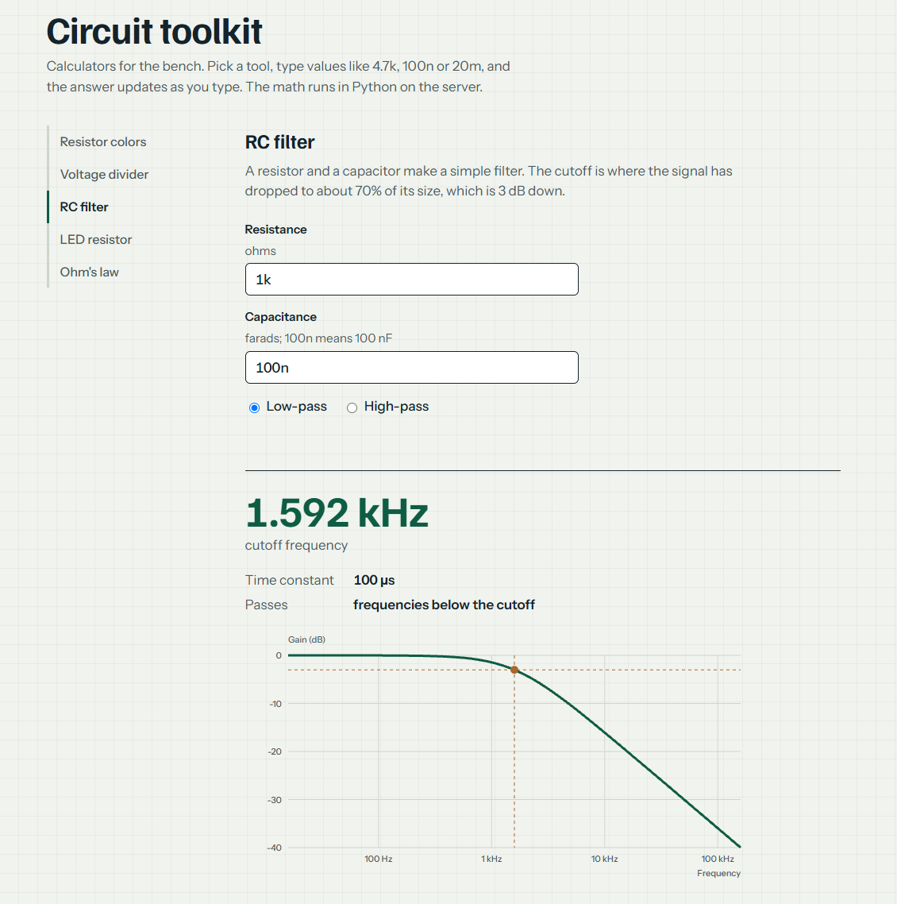

# Circuit toolkit

**Live demo:** https://circuittoolkit.vercel.app/

Browser-based calculators for common bench calculations: resistor color codes, voltage dividers, RC filters, LED series resistors and Ohm's law. Values are typed the way they appear on a schematic (`4.7k`, `100n`, `20m`) and results update as you type.



## Why I built it

I'm an electrical engineer learning web development. I wanted a project built on calculations I already know well, so that the new part was the software side: keeping logic separate from the interface, writing tests, and deploying something other people can open.

## What it does
- Resistor color code. Decodes 4-band and 5-band resistors, shows the tolerance range, and draws the resistor as you pick colors.
- Voltage divider. Output voltage, current through the divider, and power in each resistor.
- RC filter. Cutoff frequency, time constant, and a gain-versus-frequency plot for low-pass or high-pass.
- LED resistor. Calculates the exact resistance, rounds up to the nearest standard E24 value, and reports the actual LED current and resistor power.
- Ohm's law. Enter any two of voltage, current and resistance to get the third, plus power.

## How it works

The project has three parts:

- `circuit_toolkit/calc.py` holds the calculations as plain Python functions with no web code in them.
- `api/calculate.py` is a small serverless endpoint. It accepts `POST` requests with JSON like `{"tool": "voltage_divider", "inputs": {...}}` and returns `{"ok": true, "result": {...}}`, or `{"ok": false, "error": "..."}` with a 400 status for bad input.
- `public/index.html` is the frontend, written in HTML, CSS and vanilla JavaScript with no framework or build step. It parses unit suffixes, calls the API, and draws the resistor and the frequency-response plot as SVG.

It is hosted on Vercel, which serves `public/` as the site and runs `api/calculate.py` as a Python function. Pushing to main redeploys it. The Python code uses only the standard library.

## Design notes
- Math is separate from the web layer. The calculation functions can be tested without a server. There are 19 unit tests, checked against hand-calculated values (for example, 1 kΩ with 1 µF gives a cutoff of 159.15 Hz).
- The LED resistor rounds up, never down. With a 3.3 V supply, a 2 V LED and a 20 mA target, the exact value is 65 Ω. The next standard value up is 68 Ω, which gives about 19.1 mA, so the current stays at or under the target.
- Unit parsing is case-sensitive on purpose. m means milli and M means mega, as on a schematic.
- Bad input gets a clear message. A supply voltage below the LED's forward voltage, a zero resistance, or a missing field is rejected by the API with a plain-language error that the page displays.
- Local and deployed behavior match. dev_server.py runs the same request handler that Vercel runs.
- Accessibility basics. Inputs have labels, the color swatches have text labels, keyboard focus is visible, and the layout works at phone width.

## Running locally

Requires Python 3 and nothing else.

```
python dev_server.py
```
Then open http://localhost:3000. Use `python3` instead of `python` on macOS or Linux.

To run the tests:

```
python -m unittest discover tests
```

## Limitations and next steps
- Filters are first-order and the components are treated as ideal, with no tolerance, ESR or parasitic effects.
- Resistor power is calculated but not compared against a part rating.
- The tests cover the calculation layer. The API handler and the frontend were checked by hand and with a browser script that is not in this repo.
- Things I would add next: series and parallel resistors, worst-case tolerance analysis, a 555 timer calculator, and second-order filters.

## Project layout

```
circuit_toolkit/calc.py   calculation functions
api/calculate.py          serverless endpoint
public/index.html         frontend
tests/test_calc.py        unit tests
dev_server.py             local server
vercel.json               includes calc.py with the function on Vercel
```
